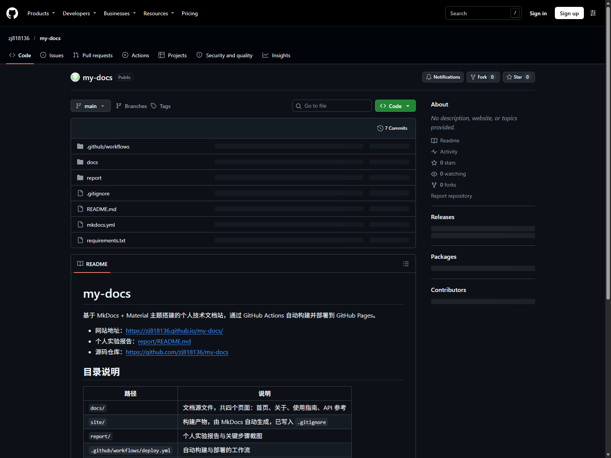
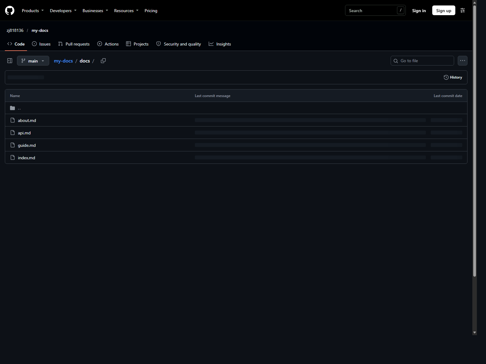
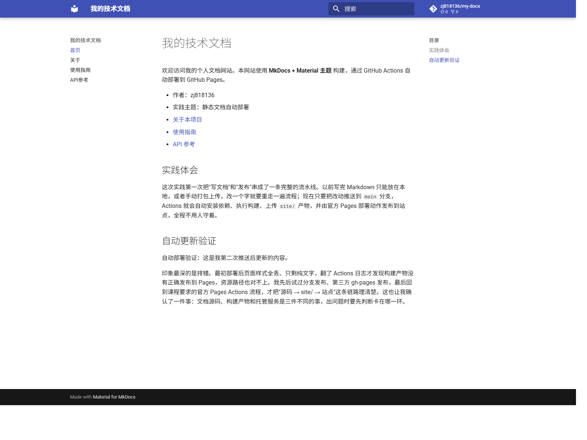
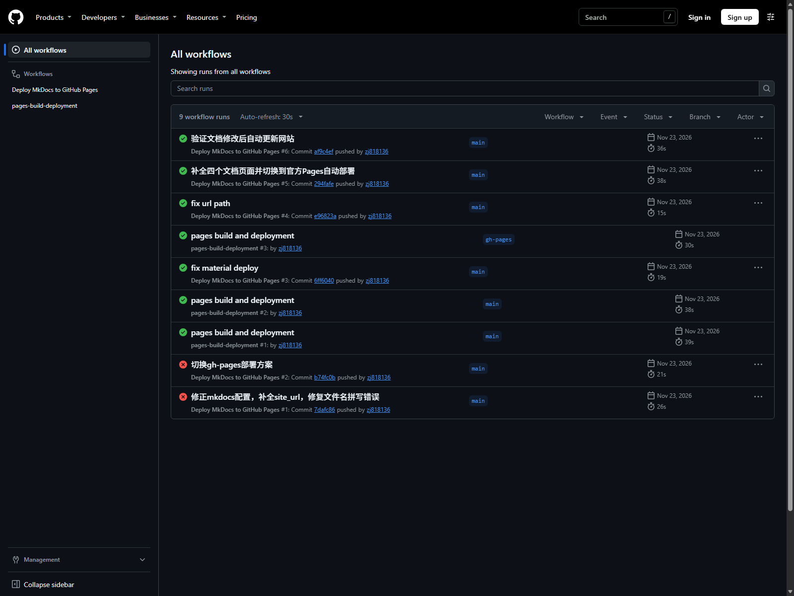
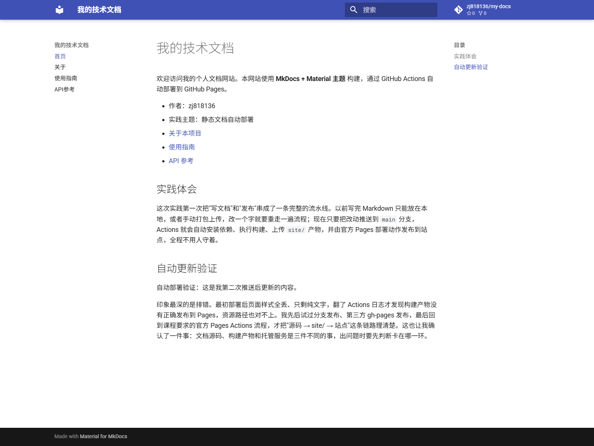
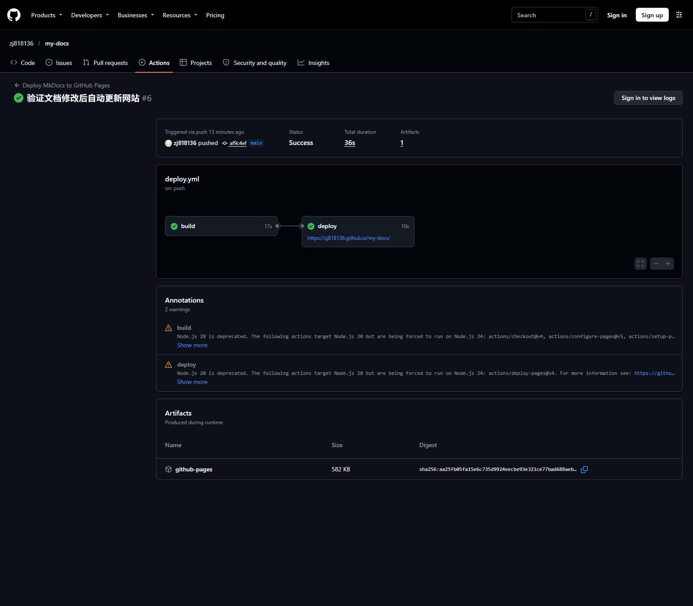

# 实践项目2：个人实验报告

## 1. 基本信息

- GitHub 登录名：zj818136
- 个人仓库地址：https://github.com/zj818136/my-docs
- 最终网站地址：https://zj818136.github.io/my-docs/

## 2. 实践过程与关键截图

### 2.1 仓库创建

在本人账号下新建公开仓库 `my-docs`，默认分支为 `main`，克隆到本地后用 `git branch --show-current` 确认当前分支为 `main`。仓库设为 Public，保证教师可以直接打开核验。



### 2.2 项目结构与 MkDocs 配置

仓库按课程要求组织：`docs/` 放四个页面（`index.md`、`about.md`、`guide.md`、`api.md`），`report/` 放本报告与截图，`.github/workflows/deploy.yml` 放自动部署工作流，根目录放 `mkdocs.yml`、`requirements.txt`、`.gitignore`、`README.md`。`site/` 是构建产物，已写入 `.gitignore`，不提交。



`mkdocs.yml` 的关键配置：

```yaml
site_name: 我的技术文档
site_url: https://zj818136.github.io/my-docs/
repo_url: https://github.com/zj818136/my-docs
use_directory_urls: false
theme:
  name: material
  language: zh
nav:
  - 首页: index.md
  - 关于: about.md
  - 使用指南: guide.md
  - API参考: api.md
```

说明：`nav` 中路径相对 `docs/` 目录，所以不写 `docs/index.md`；`use_directory_urls: false` 让构建生成 `about.html` 这类固定文件路径，避免子路径仓库中出现资源与链接错位。

### 2.3 本地构建或预览

在仓库根目录创建虚拟环境并安装依赖，用严格模式构建：

```bash
python -m venv .venv
.\.venv\Scripts\Activate.ps1
python -m pip install -r requirements.txt
python -m mkdocs build --strict
```

本地构建输出：

```text
INFO    -  Cleaning site directory
INFO    -  Building documentation to directory: ...\my-docs\site
INFO    -  Documentation built in 0.63 seconds
```

生成的 `site/` 目录中包含 `index.html`、`about.html`、`guide.html`、`api.html` 以及 `assets/` 资源目录。然后用 `python -m mkdocs serve` 启动本地预览，在 `http://127.0.0.1:8000/` 逐个检查了四页的导航、关于页的表格、API 页的代码块，以及三处以 `[返回首页](index.md)` 形式的页面间链接，均正常跳转。



### 2.4 Pages 设置

在仓库 `Settings` → `Pages` → `Build and deployment` 中，把 `Source` 设置为 **GitHub Actions**。这样发布完全由仓库内的工作流控制，不使用分支发布，因此不需要 `gh-pages` 分支，也不需要额外令牌。


### 2.5 Actions 首次构建和部署

工作流文件 `deploy.yml` 采用课程要求的官方 Pages 方案：`build` 任务安装依赖、执行 `mkdocs build --strict`、上传 `site/` 产物；`deploy` 任务在 `needs: build` 成功后才运行，使用 `actions/deploy-pages@v4` 发布。

运行记录中 `build` 与 `deploy` 两个任务均为绿色通过，部署环境为 `github-pages`，部署地址即最终网站地址。下图是仓库 Actions 的运行列表：`Deploy MkDocs to GitHub Pages` 第 5、6 次运行均为绿色通过，更早的红色记录是切换到官方方案之前的历史。



### 2.6 网站访问与四页导航检查

逐页打开验证，四个页面均返回 200：

| 页面 | 地址 | 结果 |
| --- | --- | --- |
| 首页 | `/my-docs/index.html` | 正常 |
| 关于 | `/my-docs/about.html` | 正常 |
| 使用指南 | `/my-docs/guide.html` | 正常 |
| API 参考 | `/my-docs/api.html` | 正常 |



### 2.7 第二次推送与自动更新验证

在 `docs/index.md` 中增加一句本人编写的可辨认文字：

```markdown
自动部署验证：这是我第二次推送后更新的内容。
```

提交并推送（提交信息：`验证文档修改后自动更新网站`），没有点击任何手动部署按钮，工作流由 `push` 自动触发并成功，刷新网站后新句子出现在首页，说明"改动 → 构建 → 发布"链路真实生效。

- 对应提交：`af9c4ef 验证文档修改后自动更新网站`
- 对应 Actions 运行：https://github.com/zj818136/my-docs/actions/runs/45215453684

这次运行的详情：`build` 17 秒、`deploy` 10 秒，产物 `github-pages` 共 582 KB，部署地址 `https://zj818136.github.io/my-docs/`；页面刷新后首页出现了新增的那句话（见 2.6 的网站截图，正文中含"自动部署验证"一段）。



## 3. 问题与解决

**问题一：部署后页面只剩纯文字，Material 主题样式丢失。**
现象：网站能打开，但没有侧边栏和配色，所有样式消失。
排查：打开 Actions 日志，发现构建产物没有按官方 Pages 方式上传发布，站点上实际还是旧内容；同时资源路径与站点子路径 `/my-docs/` 不匹配。
解决：改为官方 Pages 工作流（上传 `site/` 产物 + `deploy-pages`），并把 `Source` 设为 GitHub Actions，重新推送后样式恢复。

**问题二：Markdown 文件编码导致构建报 `UnicodeDecodeError`。**
现象：`mkdocs build` 报 `'utf-8' codec can't decode ...`，无法读取文档。
原因：之前用 PowerShell 的 `echo >` 重定向写文件，默认写出的是本地编码，文件不是 UTF-8。
解决：统一用 UTF-8 重新写入四个页面文件，并把所有含中文的文件都以 UTF-8 保存后再构建，严格模式构建通过。

**问题三：导航指向了不存在的旧文件名。**
现象：侧边栏出现 `shturl.md`、`test.md` 这类空页面。
原因：文件名与课程要求的 `guide.md`、`api.md` 不一致，`nav` 仍指向旧名字。
解决：重命名文档为 `guide.md`、`api.md`，同步修改 `nav`，再次构建后四页正常。

此外还核对过：`.gitignore` 是否屏蔽了 `site/` 与 `.venv/`（是）；工作流的 `paths` 触发条件是否覆盖 `docs/**` 与 `mkdocs.yml`（是）；Pages 来源未被同时设为分支发布（是）。

## 4. 原理理解

**1. `docs/` 和 `site/` 各保存什么？为什么不用手工修改 `site/`？**
`docs/` 是源文件，保存人写的 Markdown 与页面结构，是唯一需要维护的内容；`site/` 是构建产物，由 `mkdocs build` 根据 `docs/` 和 `mkdocs.yml` 生成，包含渲染后的 HTML、CSS、JS。手工改 `site/` 没有意义：下一次构建会整个覆盖它，而且它与源文件不一致，改动必然丢失，所以它写进 `.gitignore`、不提交。

**2. 本次工作流在什么情况下自动运行？**
只在 `main` 分支收到包含 `docs/**`、`mkdocs.yml`、`requirements.txt` 或工作流文件本身的推送时运行；另外配置了 `workflow_dispatch`，可以在 Actions 页面手动触发，用于首次尝试和排错。只改 `report/` 或根目录 `README.md` 不会触发部署。

**3. `build` 与 `deploy` 两个任务有什么区别？**
`build` 负责"造什么东西"：拉源码、装 Python 与依赖、执行严格构建、把 `site/` 作为 artifact 上传。`deploy` 负责"放到哪里"：通过 `needs: build` 依赖构建成功，再拿 artifact 由 `deploy-pages` 发布到 Pages 站点，并带上 `pages: write`、`id-token: write` 权限和 `github-pages` 环境。前者失败则后者不执行，这是"构建不过就不上线"的保险。

**4. 只修改 `report/README.md` 会触发部署吗？为什么？**
不会。工作流 `on.push.paths` 只列了 `docs/**`、`mkdocs.yml`、`requirements.txt` 和工作流文件，`report/` 不在其中；而报告本身也不进入网站内容，构建结果不会变化，所以省掉这次运行既避免浪费，也保证"网站更新"始终对应文档改动。

**5. 本次方案为何无需创建 `gh-pages` 分支？**
官方方案把"发布载体"从分支换成了 artifact：`upload-pages-artifact` 把 `site/` 打包成 Actions 产物，`deploy-pages` 通过 Pages 的部署 API 直接把它发布出去，全程不写入任何分支。分支发布（把构建结果推到 `gh-pages`）需要额外写权限，还容易和内置的 `pages build and deployment` 相互覆盖，官方方案没有这两个问题。
